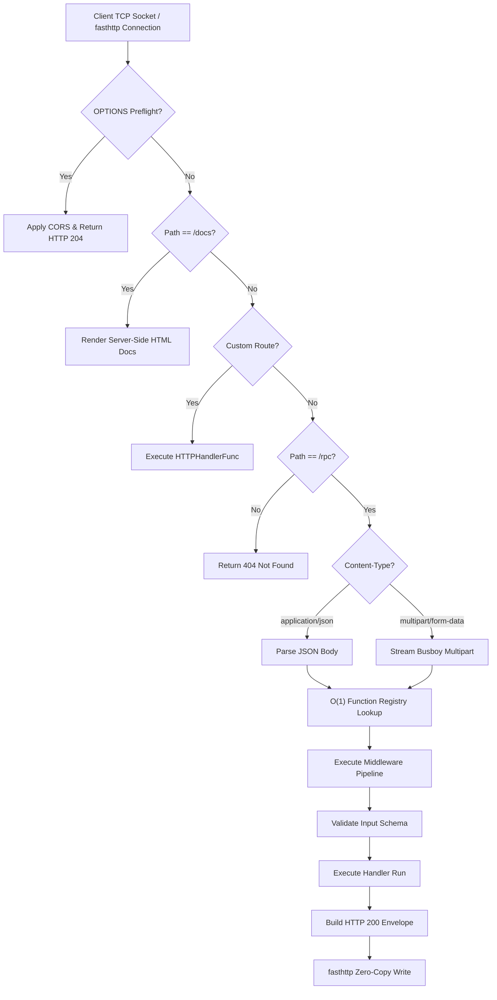

# Architecture & Execution Lifecycle

CellsWeb RPC Go is engineered for maximum throughput, sub-millisecond response times, and deterministic client behavior.

---

## 🏛️ Core Design Principles

### 1. Single-Endpoint Architecture (`POST /rpc`)
Unlike REST, which requires complex URL routing trees (e.g. `/api/v1/users/:id/posts/:postId/comments`), CellsWeb RPC routes **all operations** through a single unified endpoint:

$$\text{POST } /rpc$$

Every request payload contains three top-level fields:
```json
{
  "namespace": "user",
  "functionName": "getProfile",
  "data": { "id": "usr_101" }
}
```

### 2. $O(1)$ Function Dispatching
During startup, every function registered via Go's package `init()` is indexed into an internal hash map keyed by:

$$\text{key} = \text{namespace} + \text{"."} + \text{functionName}$$

When a request arrives, the function lookup occurs in constant time $O(1)$:
```go
app.mu.RLock()
fn, exists := app.functions[key]
app.mu.RUnlock()
```
There is zero regex evaluation, zero path splitting, and zero dynamic URL parameter parsing.

---

## 📦 Uniform HTTP 200 Protocol

CellsWeb RPC enforces a strict protocol: **every business, validation, or authentication failure returns an HTTP 200 Status Code with a standardized error envelope**.

### Success Response
```json
{
  "status": "ok",
  "data": {
    "id": "usr_101",
    "name": "Jane Doe"
  },
  "meta": {
    "requestId": "req_18d9f1a2",
    "durationMs": 0.38
  }
}
```

### Error Response
```json
{
  "status": "error",
  "code": "validation_error",
  "message": "Input validation failed: 1 field error(s)",
  "details": [
    {
      "field": "email",
      "rule": "format",
      "message": "Field 'email' must be a valid email address"
    }
  ],
  "meta": {
    "requestId": "req_18d9f1a2",
    "durationMs": 0.22
  }
}
```

### Why Uniform HTTP 200?
1. **Edge CDN & Proxy Safety**: Proxies (Cloudflare, Fastly, AWS CloudFront) frequently cache or alter HTTP 4xx/5xx error responses. HTTP 200 guarantees clean transit.
2. **Simplified Client SDKs**: The client SDK (`@cellsweb/rpc-client` or IPC bridge) simply inspects `status === "error"` and throws an `RpcError` with structured codes and details.
3. **No Ambiguous Status Codes**: Eliminates debates over whether a condition is a `400`, `422`, `403`, or `409`.

---

## ⚡ fasthttp Engine Pipeline

Under the hood, CellsWeb RPC Go uses **fasthttp**, the fastest HTTP engine in the Go ecosystem:



### Memory Optimization
- **Zero Allocations per Hot Path**: fasthttp reuses byte slices across requests using `sync.Pool`.
- **Automatic File Cleanup**: Multipart file uploads stream to sandboxed temporary files. The context tracks them (`ctx.TrackFile()`) and releases them immediately upon request termination (`ctx.Cleanup()`).

---

## 🔒 Go 1.27 `encoding/json/v2` Security & Serialization

`crpc-go` standardizes on the official Go 1.27 `encoding/json/v2` engine:

1. **Immediate Duplicate Key Rejection**:
   - Standard JSON parsers (including JavaScript `JSON.parse` and Go JSON v1) quietly accept duplicate keys (e.g. `{"role": "user", "role": "admin"}`), picking the last one.
   - Go 1.27 JSON v2 rejects duplicate keys at the parser boundary with `jsontext: duplicate object member name`, repelling parser differential and auth-bypass attacks.
2. **Nil Slice & Map Guarantee**:
   - In Go JSON v1, uninitialized `nil` slices serialized to `null`, causing frontend applications running `.map()` to throw `TypeError: Cannot read properties of null`.
   - Under JSON v2, `nil` slices automatically serialize as `[]`, and `nil` maps serialize as `{}`, preventing frontend crashes.
3. **Zero-Allocation Streaming**:
   - Responses serialize directly into response buffers using `json.MarshalWrite(buf, v)`, eliminating intermediary string allocations.
