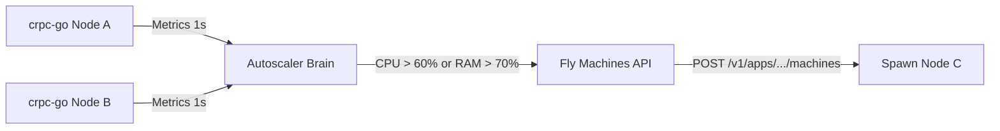

# Production Deployment & Autoscaling

CellsWeb RPC Go compiles to a single, static binary with zero runtime dependencies. A complete container image weighs **under 18 MB** and starts in less than **10 milliseconds**.

---

## 🐳 Minimal Multi-Stage Dockerfile

```dockerfile
# Stage 1: Build the static Go binary
FROM golang:1.22-alpine AS builder
WORKDIR /app

RUN apk add --no-cache git ca-certificates tzdata

COPY go.mod go.sum ./
RUN go mod download

COPY . .
RUN CGO_ENABLED=0 GOOS=linux GOARCH=amd64 go build \
    -ldflags="-w -s" \
    -o /app/server ./cmd/server

# Stage 2: Minimal scratch runtime
FROM scratch
WORKDIR /

COPY --from=builder /etc/ssl/certs/ca-certificates.crt /etc/ssl/certs/
COPY --from=builder /usr/share/zoneinfo /usr/share/zoneinfo
COPY --from=builder /app/server /server

EXPOSE 4001
ENTRYPOINT ["/server"]
```

---

## ✈️ Deploying to Fly.io

Create `fly.toml`:

```toml
app = "my-crpc-service"
primary_region = "iad"

[build]
  dockerfile = "Dockerfile"

[http_service]
  internal_port = 4001
  force_https = true
  auto_stop_machines = "stop"
  auto_start_machines = true
  min_machines_running = 1

[services.concurrency]
  type = "requests"
  soft_limit = 2500  # Proxy triggers autoscaling when active socket connections hit 2,500
  hard_limit = 5000  # Ceiling before proxy queues traffic

[[vm]]
  size = "shared-cpu-1x"
  memory = "256mb"
```

---

## 📐 Understanding Concurrency: Little's Law

Developers often ask why `soft_limit = 2500` is used when Go can handle 20,000+ requests per second.

`concurrency` measures **simultaneous active in-flight socket executions**, not throughput:

$$\text{Throughput (req/sec)} = \frac{\text{Concurrency}}{\text{Average Latency (seconds)}}$$

At **4ms average database latency**:

$$\text{Throughput} = \frac{2500}{0.004\text{s}} = \mathbf{625,000 \text{ req/sec}}$$

A soft limit of 2,500 ensures that a single machine comfortably handles up to 625,000 requests per second before the proxy routes traffic to a newly spawned instance.

---

## 🧠 Custom CPU & Memory Autoscaler ("The Brain")

Instead of relying solely on connection counts, you can run a lightweight orchestrator daemon that monitors machine CPU and RAM via Prometheus or Fly's GraphQL metrics and triggers horizontal scaling via the Fly Machines REST API:



This guarantees that compute-intensive tasks scale dynamically based on true resource exhaustion.
