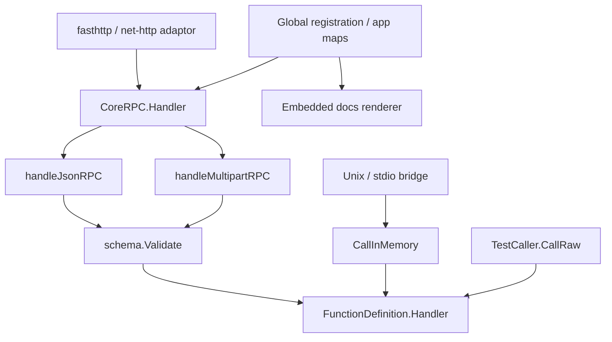

# Go architecture and source map

Read [shared contracts](protocol.md) and the [request lifecycle](lifecycle.md)
before changing a subsystem. This describes the released native implementation;
it does not propose a common pipeline or new schema API.

| Real source path | Responsibility | Test starting point |
|---|---|---|
| [pkg/rpc/engine.go](https://github.com/CellsWeb/crpc-go/blob/main/pkg/rpc/engine.go) | CoreRPC, registration copies, CORS/routing, JSON/multipart execution, HTTP serialization, listener lifecycle | engine_test.go; http_json_shapes_test.go |
| [pkg/rpc/config.go](https://github.com/CellsWeb/crpc-go/blob/main/pkg/rpc/config.go) | Explicit Config/CORS validation and defaults | engine_test.go |
| [pkg/rpc/registry.go](https://github.com/CellsWeb/crpc-go/blob/main/pkg/rpc/registry.go) | FunctionDefinition/RegisteredMiddleware/global registry and key formatting | caller_test.go; engine_test.go |
| [pkg/rpc/handler.go](https://github.com/CellsWeb/crpc-go/blob/main/pkg/rpc/handler.go) | Generic FunctionConfig/Register, schema inference, typed adaptation and file injection | caller_test.go; testing_test.go |
| [pkg/rpc/context.go](https://github.com/CellsWeb/crpc-go/blob/main/pkg/rpc/context.go) | Request/store/header/file lifetime and GetContext helper | engine_test.go; multipart_test.go |
| [pkg/rpc/caller.go](https://github.com/CellsWeb/crpc-go/blob/main/pkg/rpc/caller.go) | CallInMemory input normalization, middleware/validation/handler/output target | caller_test.go |
| [pkg/rpc/testing.go](https://github.com/CellsWeb/crpc-go/blob/main/pkg/rpc/testing.go) | TestCaller/CallRaw envelope-oriented in-process testing | testing_test.go |
| [pkg/rpc/multipart.go](https://github.com/CellsWeb/crpc-go/blob/main/pkg/rpc/multipart.go) and [pkg/rpc/file.go](https://github.com/CellsWeb/crpc-go/blob/main/pkg/rpc/file.go) | Phase1/phase2 routing/forms, application temporary files and UploadedFile | multipart_test.go |
| [pkg/rpc/http_routes.go](https://github.com/CellsWeb/crpc-go/blob/main/pkg/rpc/http_routes.go) | HTTPContext/custom raw HTTP helpers | http_routes_test.go |
| [pkg/rpc/errors.go](https://github.com/CellsWeb/crpc-go/blob/main/pkg/rpc/errors.go) | AppError/codes/validation details; engine owns HTTP mapping | engine_test.go |
| [pkg/schema/rules.go](https://github.com/CellsWeb/crpc-go/blob/main/pkg/schema/rules.go), [pkg/schema/validator.go](https://github.com/CellsWeb/crpc-go/blob/main/pkg/schema/validator.go), [pkg/schema/jsonschema.go](https://github.com/CellsWeb/crpc-go/blob/main/pkg/schema/jsonschema.go) | Native SchemaRule construction, validation/coercion and docs export | schema_test.go |
| [pkg/rpc/docs.go](https://github.com/CellsWeb/crpc-go/blob/main/pkg/rpc/docs.go) | Docs route/index/details/public schema projection | docs_parity_test.go; docs_parity_http_test.go |
| [pkg/nodebridge/bridge.go](https://github.com/CellsWeb/crpc-go/blob/main/pkg/nodebridge/bridge.go) | Unix/stdio framing, socket ownership, CallInMemory dispatch | bridge_test.go |
| [pkg/nodebridge/ts_gen.go](https://github.com/CellsWeb/crpc-go/blob/main/pkg/nodebridge/ts_gen.go) | Declaration generation from native contracts | ts_gen_test.go |
| [example-node/src/client.ts](https://github.com/CellsWeb/crpc-go/blob/main/example-node/src/client.ts) | GoRpcClient pending IDs/timers/socket-generation cleanup | example-node/test/*.test.mjs |
| [cmd/crpc-go/main.go](https://github.com/CellsWeb/crpc-go/blob/main/cmd/crpc-go/main.go) and [cmd/crpc-go/commands/init.go](https://github.com/CellsWeb/crpc-go/blob/main/cmd/crpc-go/commands/init.go) | CLI dispatch/version and generated project/env/SDK selection | commands/init*_test.go |

[pkg/utils/storage/storage.go](https://github.com/CellsWeb/crpc-go/blob/main/pkg/utils/storage/storage.go)
provides storage.Engine URL/path/upload/delete/serve helpers; uploads accept bytes,
so callers must account for read-all allocation. Its presence is not proof of a
configured external S3 integration. The
[imagehandler helper](https://github.com/CellsWeb/crpc-go/blob/main/pkg/utils/imagehandler/imagehandler.go)
uses UploadedFile.Bytes and the engine to replace/store image references; its
name does not imply an image-resizing or content-sanitization pipeline.
[storage_test.go](https://github.com/CellsWeb/crpc-go/blob/main/pkg/utils/storage/storage_test.go)
covers the storage boundary separately from RPC parser cleanup.
example, example-mongo and benchmarks contain nested modules; root tests do not
traverse them. The Go module has the actual dependencies listed in go.mod; do not
claim it has no dependency beyond one library by copying an old review summary.

There is no shared executePipeline helper or general TypeBox union interpreter.
rpc.Context is framework state, not a stdlib context.Context cancellation contract. HTTP JSON,
HTTP multipart, CallInMemory and CallRaw have separate implementations and
observable differences. Read the [validation matrix](validation.md) before
assuming a change to one path covers all others.

Continue with [registration/context](registration.md), [transport/uploads](transports.md),
[IPC lifecycle](ipc.md), [docs renderer](renderer.md), [CLI](tooling.md),
[testing](testing.md) and [release engineering](releasing.md).
The sibling [Node internals](https://cellsweb.github.io/crpc-node/internals/)
uses TypeBox and filesystem discovery instead of mirroring this implementation.
