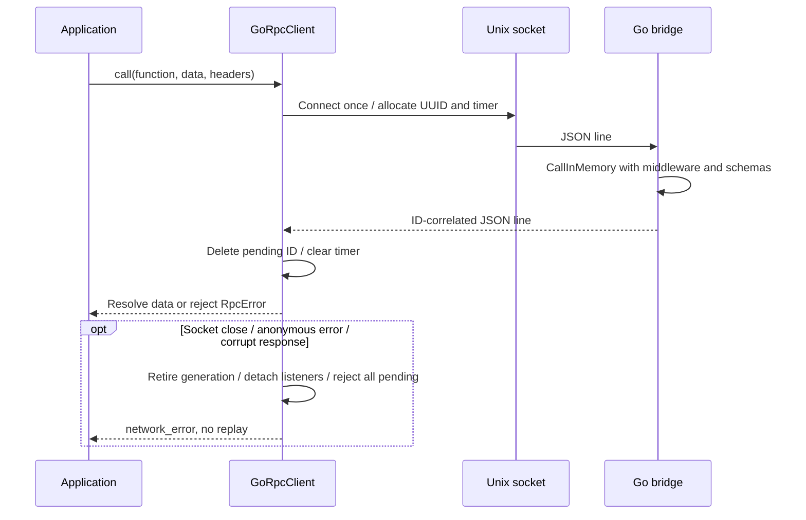

# Unix/stdio bridge and Node client lifecycle

Source: [pkg/nodebridge/bridge.go](https://github.com/CellsWeb/crpc-go/blob/main/pkg/nodebridge/bridge.go),
[example-node/src/client.ts](https://github.com/CellsWeb/crpc-go/blob/main/example-node/src/client.ts) and
[pkg/nodebridge/ts_gen.go](https://github.com/CellsWeb/crpc-go/blob/main/pkg/nodebridge/ts_gen.go). The Node HTTP SDK and this example Unix
client are different clients; do not mix their envelopes or file support.

## Wire shape and dispatch

BridgeRequest has id, function, data and optional headers. Function is the combined
key. Both bridge paths call CallInMemory with supplied headers and an output
target; no remote skipMiddlewares/context values populate trusted Context.
BridgeResponse has id/status and optional data/error/details. The bridge currently
returns an error string rather than the complete HTTP code/meta envelope. Its data
omitempty means nil output may omit data; explicit input null preservation is a
separate guarantee. Type declarations are generated from app.Functions(), not
Node filesystem discovery.

## Unix framing and daemon ownership

ServeUnixSocket prepares a parent directory, refuses to replace non-socket paths,
removes an old socket path, binds and chmods the socket 0600. Its listener/socket
cleanup is deferred when the function returns; abrupt process death may leave a
socket path for the next startup to inspect. Use an application-owned location
and supervisor policy. HTTP app shutdown does not imply this separate listener
has a stop handle.

Each accepted connection gets a goroutine; within that connection, the loop reads
one frame, executes CallInMemory and writes a response before reading the next.
The client can have several pending IDs, but this server loop does not launch a
new goroutine for every frame on that same connection.

- First-byte '{' selects newline JSON; otherwise the reader expects a4-byte
  big-endian length prefix. Emit compact object lines as the Node client does;
  do not assume arbitrary leading whitespace selects newline mode.
- MaxIPCFrameSize is **2,097,152 bytes**. Newline counts in the line limit; the
  four-byte prefix is separate from the length-framed payload maximum.
- readLineFrame uses buffered fragments and at most a capped overflow buffer,
  rejecting oversized/no-newline streams before unlimited allocation.
- Read deadlines are reset to60s for each frame; write deadlines are30s. Partial
  EOF/deadline/frame errors retire the connection. Valid framing with malformed
  request JSON yields an anonymous error and can continue at the next frame.
- Responses are JSON-Lines for both accepted request framing modes.

ServeStdio is different: bufio.Scanner reads newline tokens with the standard
approximately64KiB maximum, and scanner errors are returned. It does not accept
Unix length-prefixed frames or automatically inherit the2MiB Unix limit. This
documentation does not expand that transport or alter the wire.

## Client connection generations and pending requests

connect coalesces simultaneous connection attempts and ties event handlers to the
owning socket generation. settleRequest removes the ID before clearing its timer
and resolving/rejecting, so late replies cannot double-settle it. disconnect
closes readline/socket resources, clears the current generation and rejects all
its pending callers. Older socket events cannot retire a newer connection.

Malformed response JSON is stream corruption: reject affected pending calls and
retire that socket. Anonymous id:""/missing-ID error envelopes are connection-
level failures, not an error assigned arbitrarily to one request. Ordinary valid
matched errors remain RPC errors, timeouts settle the matching request and later
calls can reconnect. Failed calls are never automatically replayed. Some
syntactically valid non-envelope/unmatched responses are ignored by the current
parser; do not claim universal envelope validation or new wire conventions.

Use the [public IPC usage guide](../node-ipc.md), build the maintained client and
matching crpc.d.ts together, and inspect real-daemon/fault-proxy tests in
[the testing map](testing.md). IPC transports JSON, not live HTTP File/Blob objects.
