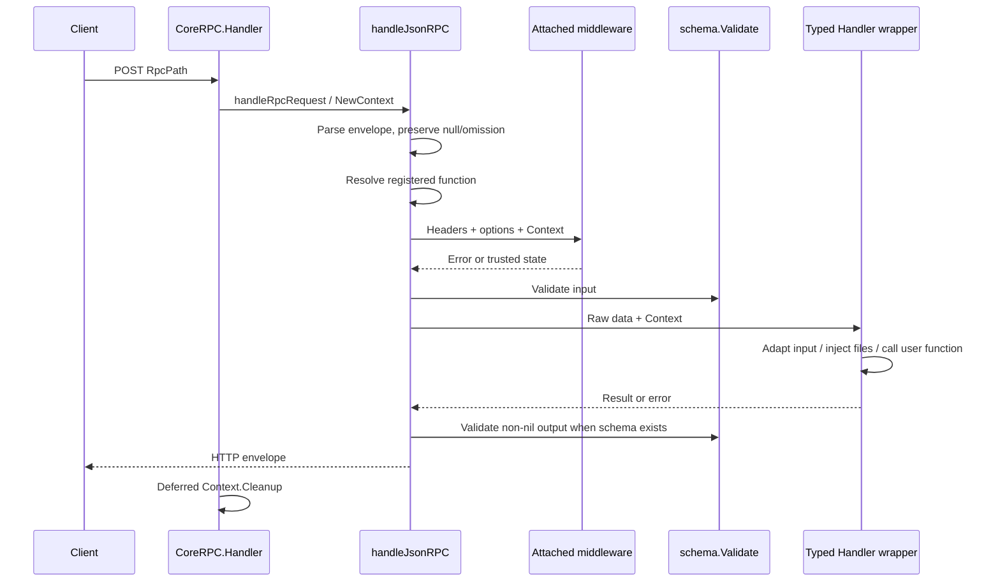

# Go request execution lifecycle

Source: [pkg/rpc/engine.go](https://github.com/CellsWeb/crpc-go/blob/main/pkg/rpc/engine.go),
[pkg/rpc/context.go](https://github.com/CellsWeb/crpc-go/blob/main/pkg/rpc/context.go) and [pkg/rpc/handler.go](https://github.com/CellsWeb/crpc-go/blob/main/pkg/rpc/handler.go).
CoreRPC owns app maps/config/server, while Context is per-request state.

## HTTP entry and routing

Handler returns the fasthttp callback. It handles OPTIONS/CORS first, then custom
HTTP routes, enabled docs, POST at RpcPath, and unmatched404. Custom HTTP routes
precede RPC/docs matching and have their own behavior; they do not automatically
execute function middleware. NetHTTPHandler wraps the request body in a configured
MaxBytesReader then adapts to the same fasthttp handler. Listen/Serve configure
body/time limits; a plain Handler used by another host depends on that host too.

## JSON path

handleRpcRequest creates Context with request ID, headers/IP and deferred cleanup.
It dispatches by Content-Type to JSON or multipart; unsupported kinds become
handled RPC errors. handleJsonRPC uses encoding/json/v2 for the envelope. A
pointer sentinel distinguishes absent data (empty object) from explicit null
(nil). Routing is trimmed/validated and FormatFunctionKey selects an app entry.

Attachments are resolved and invoked in order; a missing middleware fails closed.
Input goes through native schema.Validate. Handler invokes either the registered
raw callback or Register's generic adapter. Successful non-nil output is checked
when an output schema exists, then sendSuccessResponse serializes it. Validation
and middleware/handler errors go through sendErrorResponse/dispatchError.

## Multipart and in-memory differences

Multipart chooses paired header routing or ParseMultipartPhase1, runs middleware
before Phase2 application file writes, tracks created files, checks header/body
consistency, applies schema-directed multipart coercion and validates input. It
then executes/validates output similarly. Native fasthttp has already buffered the
request; early application authorization is not a zero-network-buffer guarantee.

CallInMemory creates its own Context and runs a separate chain. Non-nil maps keep
native values; other inputs marshal/unmarshal as arbitrary JSON shapes. It returns
an error and fills a caller-supplied output target. CallRaw uses another chain and
returns a ResponseEnvelope; it currently does not run the production output-schema
check. These paths are not aliases of one internal executePipeline method.
See [validation](validation.md) and [IPC](ipc.md) before editing shared behavior.

## Error/telemetry and resource boundaries

sendErrorResponse defaults to HTTP200; UseHttpStatusCodes invokes the explicit
mapper. Errors from malformed JSON, invalid routing and similar handled cases
also use that default, contrary to a blanket400 claim. fasthttp body/parser errors,
custom route errors and unmatched paths can occur outside the RPC wrapper.
Meta requestId/durationMs is produced by each path; the IPC response is a different
envelope and does not promise all HTTP fields.

HTTP request cleanup is deferred by handleRpcRequest; partial upload creation
errors clean files inside the multipart parser before ownership transfers to
Context. Copy files to application-owned storage while the request is alive.
Do not retain pooled fasthttp RequestCtx buffers or raw Context after response.
Config's read/write/idle deadlines bound transport operation, not arbitrary CPU
handler work. No implicit client failure replay or new cancellation API exists.

When extending behavior, enumerate HTTP JSON, multipart, CallInMemory, CallRaw and
bridge effects explicitly. A passing test for one is not coverage for all four
separate execution sites. Use the [test map](testing.md), not an incidental refactor.
