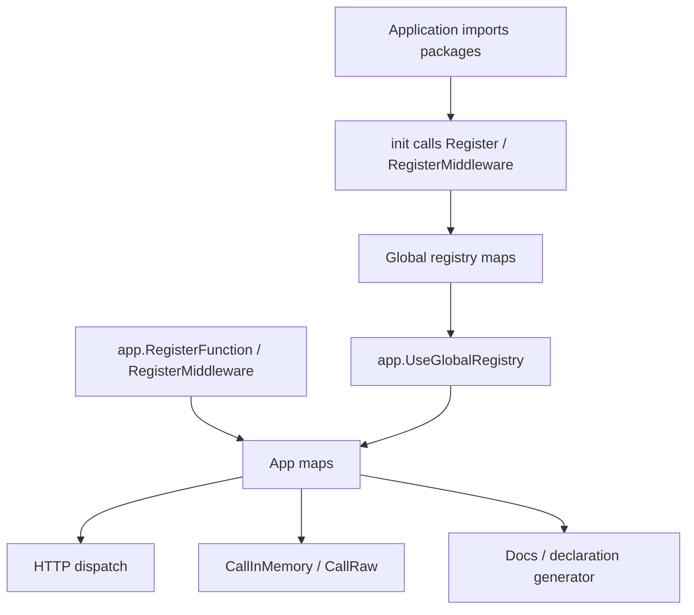

# Go registration, typed handlers and context

Source: [pkg/rpc/registry.go](https://github.com/CellsWeb/crpc-go/blob/main/pkg/rpc/registry.go), [pkg/rpc/handler.go](https://github.com/CellsWeb/crpc-go/blob/main/pkg/rpc/handler.go) and
[pkg/rpc/context.go](https://github.com/CellsWeb/crpc-go/blob/main/pkg/rpc/context.go).

## Global versus app registration

Package-level RegisterFunction/RegisterMiddleware populate global maps protected
by globalMu. Generic Register builds a FunctionDefinition and registers it globally.
UseGlobalRegistry copies entries into a CoreRPC instance; import the function and
middleware packages before calling it. A package existing on disk does not run
its init function and changes after a copy do not automatically update that app.

App.RegisterFunction/RegisterMiddleware register directly on an instance. Normal
setup completes registration before serving; do not infer safe live mutation of
all registry reads just because registration methods use locks. FormatFunctionKey
trims components and joins namespace/function; HTTP route validation remains a
separate boundary. SplitFunctionKey separates at the final dot for IPC/codegen.

## Typed wrapper

FunctionConfig includes namespace/name/content type, metadata, schemas, middleware
attachments and a Handler(ctx,input) returning *Output,error. Register infers
schemas with FromStruct when explicit schemas are absent. For precise non-object
contracts supply native rules deliberately; inference is not an arbitrary JSON
Schema/TypeBox importer.

The wrapper JSON-adapts non-nil raw input into TInput, injects top-level UploadedFile
pointers/direct file slices from native maps, then calls the user handler. Preserve
native maps containing files until that injection point. A successful JSON round
trip of a file placeholder is not evidence the live file instance survived.

## Middleware and Context

DefineMiddlewares/M express ordered attachments. RegisteredMiddleware contains a
handler and native metadata schemas for options/headers. **Those metadata schemas
do not automatically validate headers/options at execution time.** Middleware
must verify the fields it needs, authenticate credentials and authorize access.
It can use ctx.Set and typed GetContext to establish/retrieve trusted state.

Context owns a synchronized key/value store, request identity, normalized headers,
client IP/path and tracked files. Header/Headers are request data, not identity.
TrustProxy controls forwarded IP handling; review deployment trust explicitly.
Raw returns the request context only where a live HTTP request exists; in-memory
and IPC callers must not depend on HTTP-only fields.

Uploaded files tracked by HTTP Context are cleaned after request handling. SaveTo
writes a distinct application-owned destination; it does not make a temporary path
permanent. Background work must not retain request-owned resources blindly.

## Compatibility rules

Remote bridge fields named skipMiddlewares/context are legacy ignored values, not
inputs to Context.Set. IsPublic is retained/deprecated/ignored and influences no
auth, registration or docs visibility. Metadata changes should not run new runtime
validation or execute user handlers when rendering docs.

Registration/wrapper/context changes need typed/raw input fixtures, middleware
order/authorization, missing middleware, output errors and actual HTTP/IPC tests.
The [test map](testing.md) identifies exact files and API differences; do not add
Node-style filesystem discovery as a contributor convenience.
