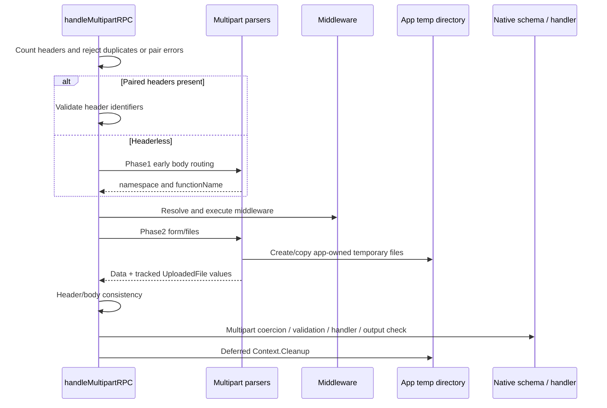

# Go HTTP, multipart and upload ownership

Source: [pkg/rpc/engine.go](https://github.com/CellsWeb/crpc-go/blob/main/pkg/rpc/engine.go), [pkg/rpc/multipart.go](https://github.com/CellsWeb/crpc-go/blob/main/pkg/rpc/multipart.go),
[pkg/rpc/file.go](https://github.com/CellsWeb/crpc-go/blob/main/pkg/rpc/file.go) and [pkg/rpc/config.go](https://github.com/CellsWeb/crpc-go/blob/main/pkg/rpc/config.go).

## Transport and configuration

Config requires an explicit RpcPath and non-nil CORS configuration. Defaults
include a10MiB request-body cap,20 multipart files and30s read/write/60s idle
transport timeouts. Native listeners pass these settings to fasthttp; NetHTTPHandler
uses a body limit wrapper/adaptor. A handler mounted in another host needs that
host's own configuration too. Core config does not load environment variables.

Go HTTP JSON parses reqCtx.PostBody with encoding/json/v2. The envelope's pointer
sentinel retains absent-versus-null semantics before validation. Multipart Phase1
also reads PostBody for fallback routing. **Native fasthttp intake is transport-
buffered**, and Phase2 calls reqCtx.MultipartForm. The subsequent copy to
application-owned temp files streams from file headers; this is not unbuffered
end-to-end socket streaming or zero aggregate memory under concurrency.

## Routing and authorization phases

Header counting uses VisitAll before Peek so duplicates are rejected, including
case variants. Headerless Phase1 requires routing text before file parts and
bounds routing fields. Phase2 still requires unambiguous body routing. Header
acceleration cannot silently override conflicting body values. Middleware runs
before Phase2 application writes, not before fasthttp has received the body.

Phase2 checks file count and size, normalizes text/JSON-looking values and arrays,
sanitizes dangerous prototype keys, handles routing-data escape names and creates
files under OS temp/crpc-uploads. Newly created directory/files request0700/0600
permissions. MIME detection inspects an initial512-byte prefix and retains declared
and detected types; neither detection nor a sanitized filename sanitizes content.
Config request limits and schema.File().MaxSize/AllowedMimes are separate checks.

## File lifetime and interruption

The parser removes already-created files if opening/sniffing/copying a later file
fails. Once parsing succeeds, handleMultipartRPC immediately registers files with
Context.TrackFile before subsequent consistency/schema/handler checks. Deferred
Context.Cleanup removes application-owned temporary paths after request handling.
Underlying fasthttp form buffering has its own lifecycle; do not count only the
app temp directory when evaluating total transport resource use.

UploadedFile exposes Filename/OriginalFilename/Size/MimeType/DeclaredMimeType/
DetectedMimeType/TempPath and Bytes/Reader/SaveTo/Cleanup methods. Bytes can allocate
an entire file. Reader must be closed by the caller. SaveTo creates a distinct
0600 destination atomically; it does not transfer ownership of the temporary path.
Persist while handling, then pass application-owned references to background jobs.

Client disconnects/transport limits can prevent delivery of a response even when
cleanup executes. Read/write timeout configuration is not a Go handler cancellation
API. Tests should include failed copies, too many/oversized/empty files, duplicate
routing, auth rejection, mismatch after parsing and temp cleanup, not just a
successful multipart upload.

Go has fasthttp and net/http entrypoints, not seven Go framework templates. The
[Node adapter guide](https://cellsweb.github.io/crpc-node/internals/transports/)
describes its different stream/Fetch boundaries. See [testing](testing.md) for
exact Go HTTP and multipart regression files.
